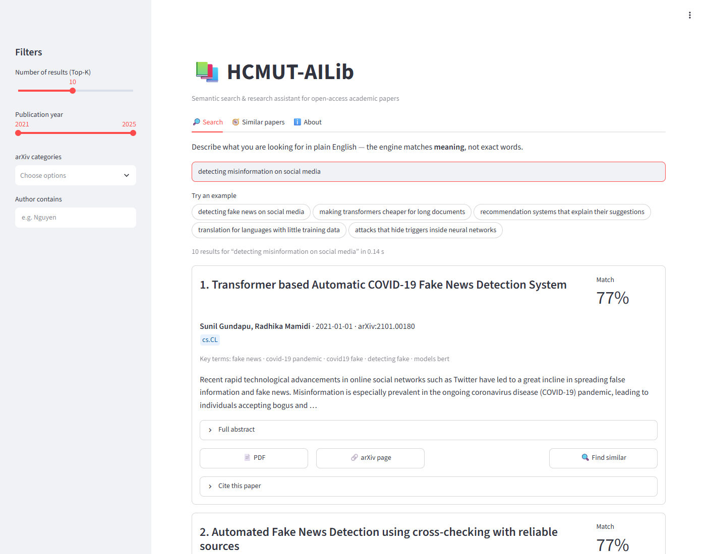
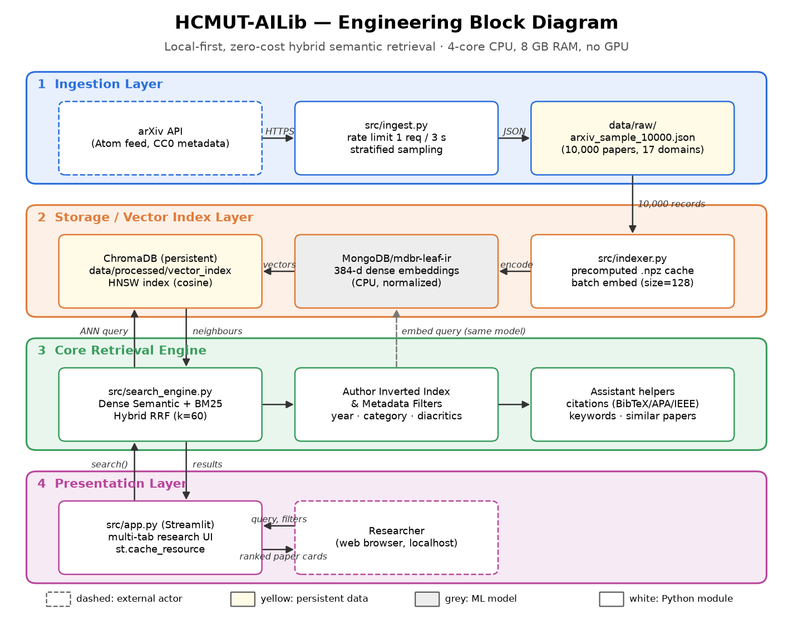

# HCMUT-AILib

[](https://github.com/HCMUT-Fus/hcmut-ailib/actions/workflows/ci.yml)
[](LICENSE)


**A zero-cost, local-first semantic search engine and research assistant for open-access academic papers.**
Built for CO2001 – Professional Skills for Engineers, Faculty of Computer Science and Engineering, HCMUT.

Library catalogues match the exact words you type. HCMUT-AILib matches *meaning*. Ask
"mixing two languages within one conversation" and it finds *A Survey of Code-switching*,
even though the two share almost no words. Everything runs on an ordinary laptop
(no GPU, no paid API, no data leaves your machine).



## Features

- **Semantic search** over 1,000 arXiv papers (cs.AI, cs.LG, cs.CL, cs.IR; 2021–2025)
- **Filters**: number of results (1–20), publication year, arXiv category, author
- **Paper cards**: match score, category badges, key terms, abstract, PDF / arXiv / DOI links
- **Find similar papers** for any result
- **One-click citations** in BibTeX, APA 7 and IEEE
- Light and dark themes; no query logging, no telemetry

## Results (v1.0.0)

Measured on a 2-core Intel i3-1115G4 laptop with 8 GB RAM, using a 30-query benchmark
([protocol](docs/benchmark_protocol.md), [raw results](reports/results/evaluation.json)):

| | HCMUT-AILib | BM25 keyword baseline | Target |
| --- | ---: | ---: | ---: |
| Mean Reciprocal Rank | **0.911** | 0.693 | > 0.7 |
| Precision@5 (ceiling 0.367) | **0.327** | 0.207 | reported |
| Query latency (mean / max) | **14 ms / 22 ms** | – | < 1.5 s |
| Index build (1,000 papers) | **51 s** | – | < 3 min |
| Cost | **$0** | | $0 |

The benchmark's relevance labels are a first pass that the QA lead still has to review.
See the [final evaluation report](reports/final_evaluation.pdf) for the method and its limitations.

## Quick start (Windows)

**Prerequisites:**
- **Windows 10 / 11** (64-bit)
- **Git** and **Python 3.12** ([download from python.org](https://www.python.org/downloads/) — tick **"Add python.exe to PATH"** during setup)
- ~**1.5 GB** of free disk space and an internet connection for the initial install and one-time model download (~90 MB)

Open **PowerShell** or **Command Prompt (CMD)** and run:

```powershell
# 1. Clone the repository
git clone https://github.com/HCMUT-Fus/hcmut-ailib.git
cd hcmut-ailib

# 2. Create an isolated Python 3.12 virtual environment
#    (If you have multiple Python versions installed, use: py -3.12 -m venv .venv)
python -m venv .venv

# 3. Install dependencies (CPU-only PyTorch first, then pinned requirements)
.venv\Scripts\python -m pip install --upgrade pip
.venv\Scripts\pip install torch==2.14.1 --index-url https://download.pytorch.org/whl/cpu
.venv\Scripts\pip install -r requirements.txt

# 4. Build the local vector index from the included dataset
#    (Required once after cloning; takes ~1 min and downloads the 90 MB model once)
.venv\Scripts\python -m src.indexer

# 5. Run the web app, then open http://localhost:8501
.venv\Scripts\streamlit run src/app.py
```

> **Tip — Activating `.venv` (optional) & other shells:**
> - Calling `.venv\Scripts\python` and `.venv\Scripts\streamlit` directly (as above) works in **PowerShell** and **CMD** without changing PowerShell's `ExecutionPolicy`.
> - If you prefer activating the environment first:
>   - **PowerShell:** `Set-ExecutionPolicy -Scope Process -ExecutionPolicy Bypass; .\.venv\Scripts\Activate.ps1`
>   - **CMD:** `.venv\Scripts\activate.bat`
>   - **Git Bash:** `source .venv/Scripts/activate` (or replace `\` with `/` in paths, e.g. `.venv/Scripts/python`)
>   - **Linux / macOS:** replace `.venv\Scripts\` with `.venv/bin/`

<details>
<summary>Other commands (tests, benchmark, reports)</summary>

```powershell
# Stop the Streamlit app (Ctrl+C) before running tests on 8 GB RAM laptops (~577 MB RSS per process)
.venv\Scripts\python -m pytest -q                             # run all 31 tests (~30 s; requires the index from step 4)
.venv\Scripts\python -m pytest -q -s tests/test_retrieval.py  # run benchmark tests and print MRR / P@5
.venv\Scripts\python -m ruff check src tests --select E9,F    # syntax & lint check (same as CI)
.venv\Scripts\python -m src.evaluate                          # full benchmark: MRR, P@5, latency, memory, PCA figure
.venv\Scripts\python reports/build_reports.py                 # rebuild PDF reports (requires Microsoft Edge)
.venv\Scripts\python docs/draw_architecture.py                # regenerate docs/architecture.png
.venv\Scripts\python -m src.ingest                            # re-download 1,000 papers from arXiv (~2 min; changes dataset & invalidates benchmark labels)
```
</details>

<details>
<summary>Troubleshooting (Windows)</summary>

| Problem | Cause & Fix |
| --- | --- |
| **`Could not open the vector index`** in the web app | The ChromaDB index (`data/processed/vector_index/`) is git-ignored. Stop the app (`Ctrl+C`), run `.venv\Scripts\python -m src.indexer`, then run `.venv\Scripts\streamlit run src/app.py` again. |
| **`No matching distribution found for torch==2.14.1`** | Your `.venv` was created with a Python version other than 64-bit Python 3.12 (check with `.venv\Scripts\python --version`). Delete `.venv` (`Remove-Item -Recurse -Force .venv`) and recreate it with `py -3.12 -m venv .venv`. |
| **PowerShell `running scripts is disabled on this system`** | Either invoke `.venv\Scripts\python` and `.venv\Scripts\streamlit` directly (no activation needed), or run `Set-ExecutionPolicy -Scope Process -ExecutionPolicy Bypass` in the current PowerShell window before `.venv\Scripts\Activate.ps1`. |
| **`No space left on device` on drive `C:`** | By default, `pip`, Hugging Face, and temp files write to `C:\Users\<user>\`. If your `C:` drive is nearly full and the repo is on another drive, redirect caches inside PowerShell before installing/running:<br>`mkdir -Force .cache\tmp, .cache\pip, .cache\huggingface`<br>`$env:TMP="$PWD\.cache\tmp"; $env:TEMP=$env:TMP; $env:PIP_CACHE_DIR="$PWD\.cache\pip"; $env:HF_HOME="$PWD\.cache\huggingface"` |
| **Out of memory / paging error during `pytest`** | Stop `streamlit run` (`Ctrl+C`) and close heavy applications before running `pytest` or `python -m src.evaluate`. |
| **Port `8501` is already in use** | Run `.venv\Scripts\streamlit run src/app.py --server.port 8502`. |
</details>

## Architecture



| Layer | Module | What it does |
| --- | --- | --- |
| Ingestion | [src/ingest.py](src/ingest.py) | arXiv API → normalized JSON ([schema](docs/data_schema.md)) |
| Vector index | [src/indexer.py](src/indexer.py) | `all-MiniLM-L6-v2` embeddings → ChromaDB (cosine, HNSW) |
| Retrieval | [src/search_engine.py](src/search_engine.py) | query embedding, top-k search, filters, find-similar |
| Assistant | [src/citations.py](src/citations.py), [src/keywords.py](src/keywords.py) | citations, key terms |
| Presentation | [src/app.py](src/app.py) | Streamlit dashboard |
| Evaluation | [src/evaluate.py](src/evaluate.py), [src/lexical_baseline.py](src/lexical_baseline.py) | benchmark vs BM25 |

## Repository layout

```
.github/            CI workflow, PR and issue templates
data/raw/           arxiv_sample_1000.json (committed)
data/processed/     vector_index/ (generated, git-ignored)
docs/               architecture, mind maps, wireframes, test plan, benchmark protocol,
                    meeting minutes, usability (SUS) kit, defence Q&A, release notes
reports/            outline_report.pdf (W3), ethics_legal_audit.pdf (W4), final_evaluation.pdf (W7)
src/                application code
tests/              pytest suite + benchmark queries and judging pool
```

## Team

| Member | Role |
| --- | --- |
| Nguyễn Phước Bảo Phú | Project Lead & System Architect |
| Từ Công Phú | Data & Retrieval Engineer |
| Nguyễn Vi Kiên | Frontend & Integration Engineer |
| Trần Kiện Đông | QA, Ethics & Compliance Lead |


## Limitations

- The model is English-only; Vietnamese queries work poorly.
- The sample has 1,000 papers, all submitted in early January of each year. A missing result does not mean the literature does not exist.
- Match scores rank results within one query; they are not comparable across queries.

## License and acknowledgements

Code: [GNU GPLv3](LICENSE). Paper metadata comes from arXiv (metadata CC0 1.0); papers
remain under their authors' licences and are only linked, never redistributed.
Thank you to arXiv for use of its open access interoperability. This project is not
affiliated with or endorsed by arXiv.
