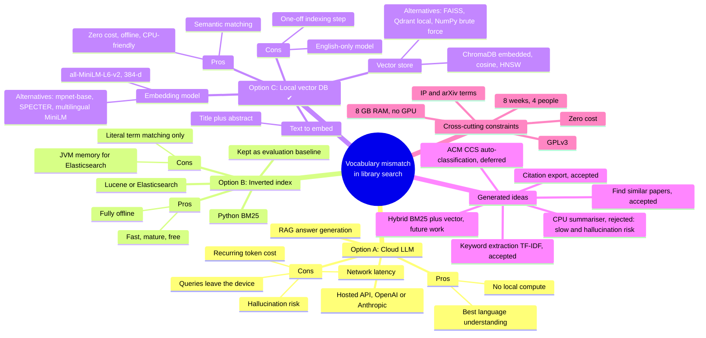

# Concept Map – Solution Space and Design Options

**Owner:** Nguyễn Vi Kiên (with input from all members) · **Design steps:** 3–5 · **Related:** `docs/feasibility_matrix.md`, outline report Sections 4–7

This map lays out the solution space explored for the vocabulary-mismatch problem. It shows the three option families, the ideas generated within each, and the trade-offs that drove the decision. It is a concept map of the design space, not a record of a specific meeting.

## Notes

- **How the map was used.** It structured the Think–Pair–Share brainstorming output (outline report, Section 4) into option families. The *Pros/Cons* branches became the scoring rationale of the weighted matrix in `docs/feasibility_matrix.md`.
- **Rejected alternatives within Option C.** FAISS is fast but needs a separate metadata store for filters. Qdrant (local mode) adds more setup. NumPy brute force is adequate for 1,000 vectors but provides no persistence or metadata filtering. ChromaDB offers persistence, metadata `where` filters and HNSW in one embedded package. `all-mpnet-base-v2` is more accurate but roughly 5× larger and slower on CPU. SPECTER-style scientific encoders are a candidate for future work.
- **Decision.** Option C was selected (weighted total 4.40 vs 3.85 for B and 2.90 for A).
