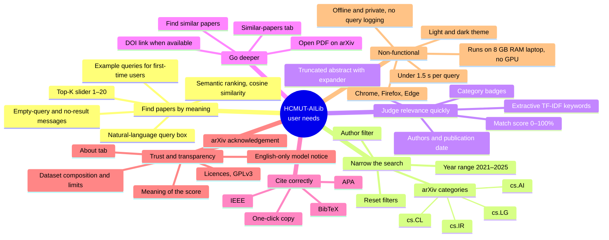

# Concept Map – Features and User Requirements

**Owner:** Nguyễn Vi Kiên · **Design steps:** 3–4 · **Related:** `reports/src/outline_report.md` Section 8, `docs/ui_wireframes.md`

This concept map organises the features and user requirements of HCMUT-AILib by user need. It is a synthesis artefact. It summarises the requirement space that informed the outline report, and is not a transcript of any particular session. It renders on GitHub, or in any Mermaid ≥ 9.3 viewer.

## Notes

- **Prioritisation (MoSCoW).** *Must:* query, ranking, Top-K, filters, result card, links, citations, About tab, feedback messages. *Should:* find similar, keywords, example queries. *Could:* light/dark theme polish, result export. *Won't (v1.0):* user accounts, full-text search, generated summaries, multilingual queries.
- **Traceability.** Each leaf maps to a functional requirement (FR1–FR10) or a non-functional requirement (NFR1–NFR6) in the outline report, Section 8.3–8.4. It is verified by the manual E2E checklist in `docs/test_plan.md`.
- **Validation.** The Week 7 usability study (`docs/usability/sus_survey.md`) checks whether these needs are actually met for HCMUT students.
