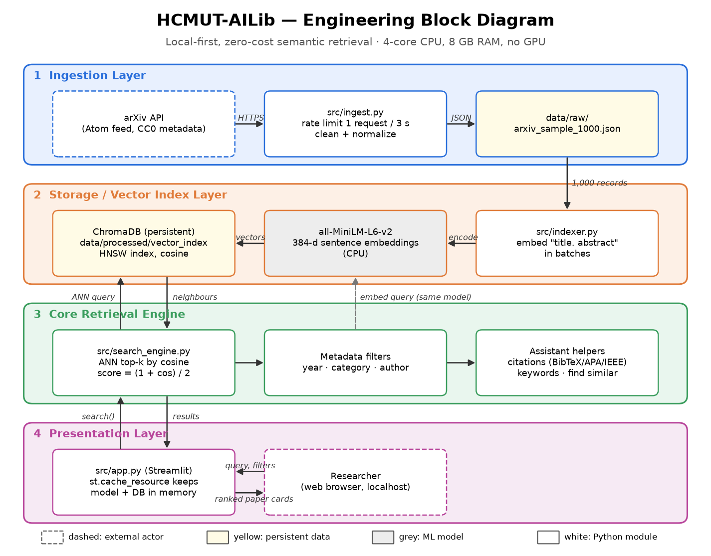
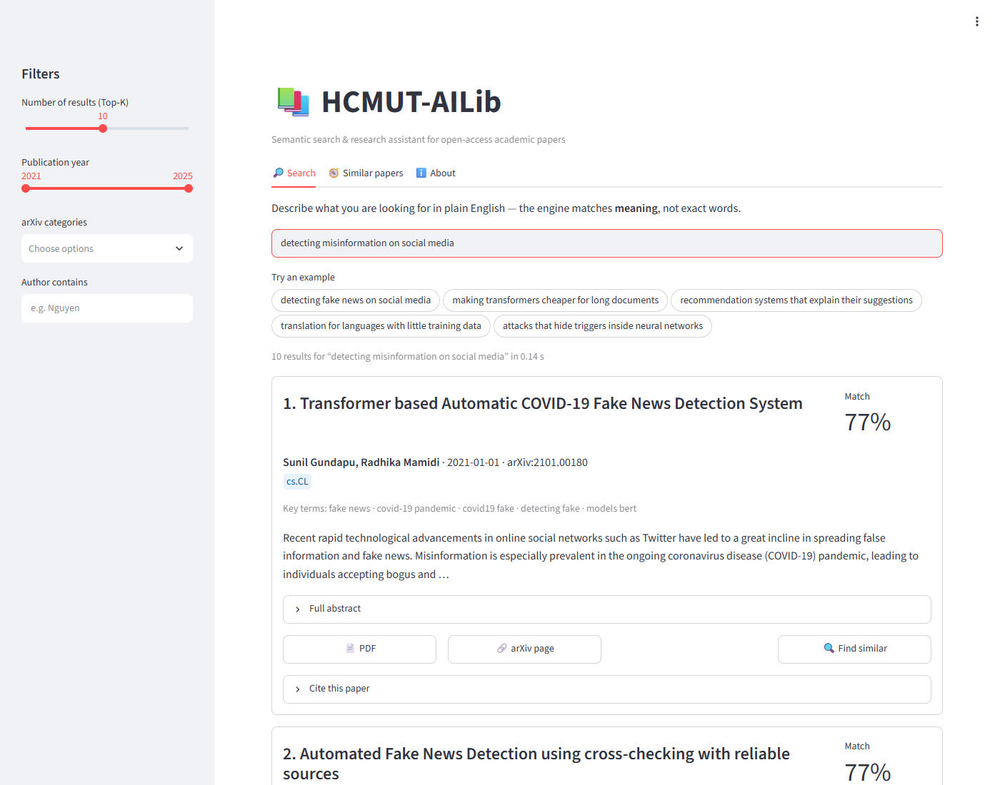
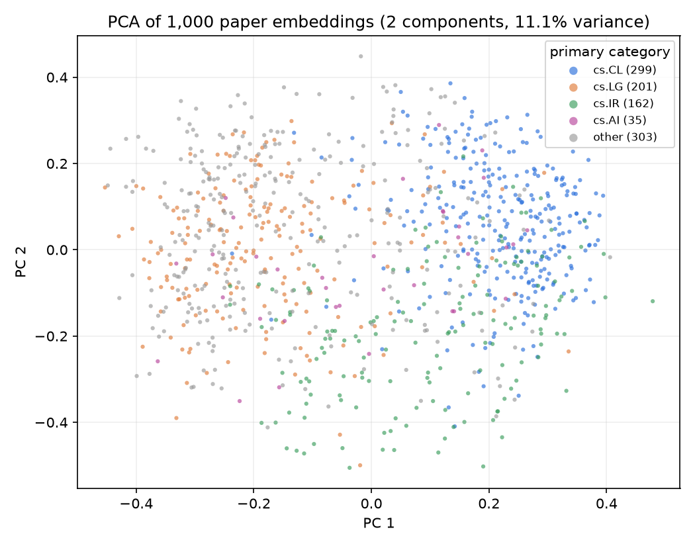

<div class="titlepage" markdown="1">

**VIETNAM NATIONAL UNIVERSITY – HO CHI MINH CITY**<br>
**HO CHI MINH CITY UNIVERSITY OF TECHNOLOGY (HCMUT)**<br>
**FACULTY OF COMPUTER SCIENCE AND ENGINEERING**

&nbsp;

Course: **CO2001 – Professional Skills for Engineers**<br>
Class CC02 – Group 13 – Semester 1, Academic Year 2026–2027

&nbsp;

# HCMUT-AILib

**A Zero-Resource Semantic Retrieval and Research Assistant for Digital Academic Libraries**

**Milestone 3 – Final Evaluation Report (Week 7)**

&nbsp;

| Member | Role |
| :--- | :--- |
| Nguyễn Phước Bảo Phú | Project Lead & System Architect |
| Từ Công Phú | Data & Retrieval Engineer |
| Nguyễn Vi Kiên | Frontend & Integration Engineer |
| Trần Kiện Đông | QA, Ethics & Compliance Lead |

Repository: `github.com/HCMUT-Fus/hcmut-ailib` · Release: `v1.0.0` · Licence: GNU GPLv3

Ho Chi Minh City, 2026

</div>

<div class="toc" markdown="1">

[TOC]

</div>

## Abstract

HCMUT-AILib is a local-first, zero-cost semantic search engine and research assistant for academic papers. It addresses the vocabulary-mismatch problem of keyword catalogues [1] by embedding the titles and abstracts of 1,000 open-access arXiv papers with the `all-MiniLM-L6-v2` sentence-embedding model [2], [3], indexing them in an embedded ChromaDB store [7], and serving ranked, filterable results with citation export through a Streamlit interface [8]. This report presents the delivered system and evaluates it against the criteria set in the Outline Report. On a 30-query benchmark with pooled relevance judgements, the system reaches a **Mean Reciprocal Rank of 0.911** (target > 0.7), against 0.693 for an Okapi BM25 keyword baseline [4]. Mean query latency is **13.6 ms** (maximum 22.2 ms; target < 1.5 s), and the full index is built in **51 s** on a 2-core laptop CPU with no GPU, at zero monetary cost. Precision@5 is 0.327, close to the 0.367 ceiling imposed by the benchmark's small number of relevant papers per query. We also report what is not yet finished or not yet proven: the relevance labels must still be re-checked by a human judge, the usability study (SUS) has not been run, the advantage over BM25 is not statistically significant at the 5 % level with 30 queries (sign test, p = 0.057), and memory use (577 MB) is about four times the early estimate.

## 1. Introduction

The Outline Report (Milestone 1) defined the problem, constraints and design; the Ethics and Legal Audit (Milestone 2) established the compliance framework. This report closes design step 7 (build the prototype) and step 8 (test and refine). It answers three questions:

1. **Does the prototype meet the measurable criteria K1–K7?** (Section 6)
2. **Does semantic retrieval actually beat keyword retrieval on natural-language queries?** (Section 5.2)
3. **What are the limitations, and how far does the design scale?** (Sections 7 and 8)

All numbers in this report come from `python -m src.evaluate`, whose raw output is committed as `reports/results/evaluation.json`, and from the automated test suite.

## 2. Delivered System

### 2.1 Architecture

The system implements the four-layer architecture selected in Milestone 1 (Figure 1). Every layer runs on the user's computer; the only network access is the one-off download of open metadata from the arXiv API and of the embedding model.



*Figure 1 – Engineering block diagram. Data flows from the arXiv API (layer 1) into the vector index (layer 2); the retrieval engine (layer 3) serves the Streamlit interface (layer 4).*

### 2.2 Modules

| Module | Owner | Responsibility | Size |
| :--- | :--- | :--- | ---: |
| `src/ingest.py` | Từ Công Phú | Query the arXiv API (≥ 3 s between requests, retry with back-off), parse Atom XML, normalise records, de-duplicate cross-listed papers | 170 lines |
| `src/indexer.py` | Từ Công Phú | Embed `"title. abstract"` in batches of 64, write vectors and flat metadata to a persistent ChromaDB collection (cosine space, HNSW [6]) | 100 lines |
| `src/search_engine.py` | Nguyễn Phước Bảo Phú | Embed the query, ANN top-*k* search, year/category filters as ChromaDB `where` clauses, author filter, score normalisation, find-similar | 140 lines |
| `src/citations.py`, `src/keywords.py` | Từ Công Phú | BibTeX / APA 7 / IEEE citation strings; TF-IDF extractive key terms | 135 lines |
| `src/app.py` | Nguyễn Vi Kiên | Streamlit dashboard: search, sidebar filters, paper cards, citations, similar papers, About tab | 190 lines |
| `src/lexical_baseline.py`, `src/metrics.py`, `src/evaluate.py` | Trần Kiện Đông | BM25 baseline, MRR / P@k / Recall@k, benchmark, latency, memory and PCA measurements | 270 lines |
| `tests/` (4 files) | Trần Kiện Đông | 31 automated tests: parsing, dataset integrity, citations, keywords, BM25, filters, benchmark, latency, UI | 31 tests |

**Relevance score.** ChromaDB returns a cosine distance *d* ∈ [0, 2]. The interface shows the match score *s* = (1 + (1 − *d*)) / 2 = 1 − *d*/2 ∈ [0, 1] as a percentage. The score orders results; it is not a calibrated probability of relevance, and the About tab says so.

### 2.3 Dataset

`data/raw/arxiv_sample_1000.json` holds 1,000 records (1.7 MB). The sample is stratified: for each of the categories cs.AI, cs.LG, cs.CL and cs.IR and each submission year 2021–2025, the first 50 papers not already sampled were taken (4 × 5 × 50 = 1,000). Each record carries `id`, `title`, `abstract`, `authors`, `doi`, `categories`, `primary_category`, `published_date` and `pdf_url` (schema in `docs/data_schema.md`). Abstracts average 177 words; 166 papers (16.6 %) have a publisher DOI. Because of cross-listing, 303 papers have a primary category outside the four sampled ones (e.g. cs.CV, eess.IV), which broadens the topical coverage.

### 2.4 User interface

Figure 2 shows the search page. All the functional requirements in the Outline Report (FR1–FR10) are implemented: a free-text query box with example queries, a Top-K slider (1–20), year, category and author filters, paper cards with the match score, category badges, five key terms, a truncated abstract with a full-abstract expander, PDF / arXiv / DOI links, a "Find similar" action, and BibTeX, APA and IEEE citations with a copy button. Streamlit's light and dark themes are both supported. A "no results" warning, an empty-query prompt and a loading spinner give feedback. The model and database connection are cached with `st.cache_resource`, so they load only once per server process.



*Figure 2 – Search results for "detecting misinformation on social media". The top result is about fake-news detection, although the query never uses the word "fake".*

### 2.5 Quality assurance

The GitHub Actions workflow (`.github/workflows/ci.yml`) runs on every push and pull request to `main` and `develop`. It checks syntax with `compileall` and `ruff`, runs the offline unit tests, rebuilds the index from the committed dataset, and then runs the retrieval benchmark (which asserts MRR > 0.7 and latency < 1.5 s) and the headless UI tests (`streamlit.testing`). Locally, all **31 tests pass** in 30 s. The arXiv API is never called from CI; ingestion is tested on a recorded Atom fixture.

## 3. Evaluation Method

### 3.1 Benchmark construction

The full protocol is in `docs/benchmark_protocol.md`. In summary:

1. **Seeds.** 30 seed papers were drawn at random from the dataset (`random.seed(2001)`), so no paper was hand-picked.
2. **Queries.** One natural-language query was written per seed from its abstract. Each query describes an information need and avoids the seed's title wording where possible. Example: the seed *"Privacy-sensitive Objects Pixelation for Live Video Streaming"* became *"blurring sensitive objects in real-time video broadcasts to protect privacy"*. All 30 queries were frozen before either system was run.
3. **Pooling.** For each query, the top-10 results of both systems were merged (500 candidates, 16.7 per query). Candidates were shown sorted by id, without the retrieving system, and judged binary-relevant if they address the query's core information need.
4. **Result.** 58 relevant labels, 1–7 per query (mean 1.93).

### 3.2 Metrics

* **MRR** (criterion K2): mean over queries of 1 / rank of the first relevant result in the top 10 [5].
* **Precision@5** (K3): relevant papers in the top 5, divided by 5. With only 1.93 relevant papers per query on average, no system can exceed **P@5 = 0.367** on this benchmark (the mean of min(#relevant, 5) / 5). We therefore also report P@5 as a fraction of this ceiling.
* **Recall@10:** relevant papers found in the top 10, as a share of all labelled relevant papers. Labels exist only for pooled candidates, so this recall is *pool-relative* and overstates true recall.
* **Latency** (K1): wall-clock time of `SearchEngine.search(query, top_k=10)`, covering query embedding and the ANN query, for 30 queries × 5 repetitions after 3 warm-up queries.

### 3.3 Test environment

| Item | Value |
| :--- | :--- |
| CPU | Intel Core i3-1115G4 @ 3.0 GHz – 2 cores / 4 threads (below the 4-core reference laptop in constraint C2) |
| RAM | 8 GB (7.7 GB usable); no discrete GPU |
| OS / Python | Windows 11 (build 26200) / Python 3.12.10 |
| Libraries | torch 2.14.1 (CPU), sentence-transformers 6.1.0, chromadb 1.5.9, streamlit 1.66.0 |

## 4. Baseline

The A/B comparison uses Okapi BM25 [4] (k₁ = 1.5, b = 0.75) over the same title + abstract text, with the same tokeniser and stop-word list (`src/lexical_baseline.py`). BM25 is the standard strong baseline for keyword search and is the ranking function used by Lucene/Elasticsearch, i.e. Option B of the Outline Report's decision matrix.

## 5. Results

### 5.1 Retrieval accuracy

| System | MRR | P@5 | P@5 / ceiling | Recall@10 (pool) | Top-1 correct |
| :--- | ---: | ---: | ---: | ---: | ---: |
| **HCMUT-AILib (semantic)** | **0.911** | **0.327** | **89 %** | **1.000** | **25 / 30** |
| BM25 keyword baseline | 0.693 | 0.207 | 56 % | 0.744 | 19 / 30 |
| Target (Outline Report) | > 0.7 | reported | – | – | – |

The semantic engine meets the accuracy criterion with a clear margin (0.911 vs 0.7). BM25 falls just short of the target (0.693).

### 5.2 A/B comparison: semantic vs keyword search

Per query, the semantic engine has a higher reciprocal rank than BM25 on **11** queries, a lower one on **3**, and ties on **16** (mostly cases where both systems rank a relevant paper first). A two-sided sign test on the 14 untied queries gives **p = 0.057**. The direction strongly favours semantic search, but with 30 queries the difference is **not statistically significant at α = 0.05**. A larger benchmark is needed before claiming a significant improvement.

The clearest wins are queries whose wording differs from the papers':

| Query | BM25 result | Semantic result |
| :--- | :--- | :--- |
| Q06 "how humans learn to decide when to stop deliberating and act" | no relevant paper in the top 10 (top hit: *Impact of Stop Sets on Stopping Active Learning*, matched on "stop") | rank 1: *Have I done enough planning or should I plan more?* |
| Q17 "mixing two languages within one conversation and its implications for NLP" | no relevant paper in the top 10 | rank 1: *A Survey of Code-switching* |
| Q08 "jointly grouping documents and discovering their topics without supervision" | no relevant paper in the top 10 | rank 1: *ClusTop: … text clustering and topic extraction* |
| Q02 "recognizing person and organization names when very little labelled training text is available" | no relevant paper in the top 10 | rank 2: *… Low-Resource Named Entity Recognition* |

In each case the relevant paper uses technical terms (code-switching, NER, topic extraction, planning) that the query paraphrases. This is exactly the vocabulary mismatch that motivated the project.

### 5.3 Failure analysis

The semantic engine did not rank a relevant paper first on five queries:

| Query | First relevant at | What ranked higher | Diagnosis |
| :--- | :---: | :--- | :--- |
| Q02 NER with little labelled data | 2 | *CompanyName2Vec: Company Entity Matching* | "organization names" matched company-name matching; score gap 0.002 |
| Q05 transformers for spreadsheet-style data | 2 | *Subformer* (weight sharing in transformers) | the model weights "transformer" over "spreadsheet/tabular" |
| Q19 survey of summarisation methods | 2 | *Summaformers @ LaySumm 20* (a system, not a survey) | embeddings capture topic, not document type ("survey") |
| Q20 parameterised deterministic lookahead policies | 3 | two MDP papers | specialised operations-research vocabulary; BM25 ranks it first |
| Q21 learning navigation cost from demonstrations | 2 | *Modeling … the Dynamics of Human Learning* | "learning from demonstration" vs. "human learning" confusion |

On Q19, Q20 and Q21, BM25 does better, because a rare exact term ("survey", "deterministic", "navigation") is decisive. This suggests that a **hybrid** ranking (semantic + BM25, e.g. reciprocal rank fusion) is the most promising refinement. It was proposed as an idea in step 4 of the design process.

### 5.4 Performance and resources

| Measure | Result | Target | Status |
| :--- | ---: | ---: | :---: |
| Query latency – mean / median | 13.6 ms / 13.3 ms | < 1.5 s | ✔ |
| Query latency – p95 / max (n = 150) | 17.1 ms / 22.2 ms | < 1.5 s | ✔ |
| Index build, 1,000 papers (model cached) | 51.5 s | < 3 min | ✔ |
| Cold start (load model + open index) | 15.3 s | – | once per server |
| Process memory (RSS) after queries | 577 MB | ≈ 140 MB (estimate) | ✘ estimate, ✔ 8 GB limit |
| Vector index on disk | 18 MB | – | – |
| Monetary cost | $0.00 | $0.00 | ✔ |

Latency is about 70 times below the threshold even on a weaker CPU than the reference laptop. The Week-1 estimate of ~140 MB counted only the model weights; the measured 577 MB is dominated by the PyTorch runtime. This is still under 8 % of an 8 GB laptop, so constraint C2 holds, but the estimate was wrong and we correct it here. CPU utilisation was not instrumented; each query is a single ~14 ms burst.

### 5.5 Embedding space

Figure 3 projects the 1,000 embeddings onto their first two principal components. Even in this two-dimensional view (11.1 % of variance), the categories separate along a language (cs.CL) ↔ learning theory (cs.LG) axis, with information retrieval (cs.IR) in between. This qualitative check suggests the embeddings encode research topic, which the ranking relies on.



*Figure 3 – PCA of the 384-dimensional embeddings, coloured by primary arXiv category.*

## 6. Criteria Compliance

| ID | Criterion | Target | Result | Status |
| :--- | :--- | :--- | :--- | :---: |
| K1 | Query latency | < 1.5 s | max 22.2 ms | ✔ Met |
| K2 | Retrieval accuracy | MRR > 0.7 | 0.911 (BM25 0.693) | ✔ Met* |
| K3 | Early precision | P@5 reported vs BM25 | 0.327 vs 0.207 (89 % of ceiling) | ✔ Met |
| K4 | Indexing time | < 3 min | 51.5 s | ✔ Met |
| K5 | Usability | SUS ≥ 68 | study not yet run | ☐ Pending |
| K6 | Reproducibility | clone → running app in 3 commands | verified in a fresh virtual environment on the development machine; clean-machine test pending | ◐ Partial |
| K7 | Quality assurance | 100 % tests pass in CI | 31 / 31 pass locally; first CI run happens on the next push to GitHub | ◐ Partial |
| C1 | Zero cost | $0.00 | $0.00 | ✔ Met |
| C2 | Commodity hardware | 4-core CPU, 8 GB, no GPU | runs on a 2-core / 8 GB laptop | ✔ Met |
| C4 | Open data only | metadata only, no full text | metadata + abstracts; PDFs only linked | ✔ Met |

\* Subject to the human re-judgement of the relevance labels described in Section 8.1.

The original plan also listed "Precision@5 > 80 %". Section 3.2 shows that this target is unreachable for any system on a benchmark with fewer than five relevant papers for most queries, so we report P@5 relative to its ceiling instead.

## 7. Usability Study (to be completed)

The SUS study protocol, task list and questionnaire are in `docs/usability/sus_survey.md` (10–15 HCMUT students, standard 10-item SUS [9]). **The study has not been conducted at the time of writing, and no usability results are reported here.** The table below is to be filled in by Nguyễn Vi Kiên after the sessions.

| Measure | Result |
| :--- | :--- |
| Participants (n) | – |
| Mean SUS score (± SD) | – |
| Task completion rate | – |
| Median time: query → copy citation | – |
| Most frequent issues | – |

## 8. Limitations and Threats to Validity

### 8.1 Benchmark validity

* **Who judged.** The first-pass relevance labels were drafted with the help of an AI coding assistant working from titles and abstracts, following the written rules in `docs/benchmark_protocol.md`. The Outline Report committed to human-annotated ground truth, so **the QA lead must re-judge all 500 pooled candidates before submission** and update the numbers if any labels change.
* **Single judge, binary labels.** There is no inter-annotator agreement and no graded relevance.
* **Seed bias.** Each query was written from a specific paper, which favours finding that paper. Queries written by real students without looking at the collection would be a harder and more realistic test.
* **Pooling bias.** Papers retrieved by neither system were never judged. Recall@10 = 1.0 for the semantic engine only means it found every *labelled* paper.
* **Size.** 30 queries give wide confidence intervals; the 11–3 win/loss split is not significant at the 5 % level.

### 8.2 System limitations

* **English only.** `all-MiniLM-L6-v2` is trained on English text. Vietnamese queries will retrieve poorly; a multilingual model (e.g. `paraphrase-multilingual-MiniLM-L12-v2`) would be needed for Vietnamese users.
* **Sampling window.** Because the arXiv API was queried in ascending date order, every sampled paper was submitted in the first days of January of its year. The collection is stratified by year and category, but not by month, so it under-represents topics that peak later in the year. A future ingest should sample across months; this requires rebuilding the benchmark.
* **Abstract-level retrieval.** Only titles and abstracts are embedded; content found only in the full text cannot be retrieved.
* **Document type.** Embeddings capture topic, not genre: "survey" or "benchmark" in a query has little effect (Q19).
* **Score meaning.** Match scores cluster between 0.7 and 0.8 and are not comparable across queries.

## 9. Scalability Analysis

| Collection size | Ingestion (100 records / request, 3 s) | Embedding (≈ 51 ms / paper on this CPU) | Index size (≈ 18 KB / paper) | Query latency |
| ---: | ---: | ---: | ---: | :--- |
| 1,000 (now) | 1.5 min | 51 s | 18 MB | 14 ms (measured) |
| 10,000 | 5 min | ≈ 9 min | ≈ 180 MB | HNSW is sub-linear [6]: expected to stay in the tens of ms |
| 100,000 | 50 min | ≈ 85 min (one-off; incremental updates afterwards) | ≈ 1.8 GB | expected well under 1 s; to be verified |

Extrapolations assume linear embedding cost and per-paper index size, and are not measurements. The main bottleneck at scale is the one-off embedding time, which can run overnight or be split across machines. Query embedding time does not depend on collection size. Beyond about 10⁵ papers, the in-process author filter (which scans the whole collection) should be replaced by a proper full-text index.

## 10. Ethical and Professional Considerations

The Milestone 2 audit (`reports/ethics_legal_audit.pdf`) covers the legal analysis. In the delivered system:

* Only open metadata is stored. PDFs are linked, never downloaded or redistributed. The ingestion script enforces arXiv's rate limit and identifies itself with a descriptive User-Agent.
* The About tab acknowledges arXiv as required, states that the project is not endorsed by arXiv, and explains what the match score means and what its limits are.
* Queries are processed locally and never logged; Streamlit usage statistics are disabled (`.streamlit/config.toml`).
* Citation export encourages correct attribution of the retrieved work.
* **AI assistance disclosure.** Parts of the source code, documentation and this report were drafted with an AI coding assistant, and the first-pass benchmark labels were AI-assisted (Section 8.1). The team has reviewed the material and is responsible for it. This disclosure is made in line with academic-integrity expectations; the team should check the course's specific AI-use policy.

## 11. Conclusion and Future Work

HCMUT-AILib meets its core engineering criteria on commodity hardware at zero cost. It achieves an MRR of 0.911 against a target of 0.7, maximum latency of 22 ms against a 1.5 s target, and index construction in 51 s against a 3-minute target. On queries phrased differently from the papers, it consistently outperforms a strong keyword baseline. The remaining work before the final defence is procedural rather than technical:

1. human re-judgement of the benchmark labels (Đông);
2. the SUS usability study (Kiên);
3. the clean-machine reproducibility test (Công Phú);
4. the first green CI run on GitHub and the `v1.0.0` tag (Bảo Phú).

The most valuable technical refinements are:

1. hybrid semantic + BM25 ranking, to fix the rare-term failures in Section 5.3;
2. a multilingual embedding model, for Vietnamese queries;
3. month-stratified ingestion and a larger, student-written query set, for a statistically meaningful comparison.

## References

[1] G. W. Furnas, T. K. Landauer, L. M. Gomez, and S. T. Dumais, "The vocabulary problem in human-system communication," *Commun. ACM*, vol. 30, no. 11, pp. 964–971, Nov. 1987.

[2] N. Reimers and I. Gurevych, "Sentence-BERT: Sentence embeddings using Siamese BERT-networks," in *Proc. EMNLP-IJCNLP*, Hong Kong, China, 2019, pp. 3982–3992.

[3] W. Wang, F. Wei, L. Dong, H. Bao, N. Yang, and M. Zhou, "MiniLM: Deep self-attention distillation for task-agnostic compression of pre-trained transformers," in *Advances in Neural Information Processing Systems 33*, 2020, pp. 5776–5788.

[4] S. Robertson and H. Zaragoza, "The probabilistic relevance framework: BM25 and beyond," *Foundations and Trends in Information Retrieval*, vol. 3, no. 4, pp. 333–389, 2009.

[5] E. M. Voorhees, "The TREC-8 question answering track report," in *Proc. TREC-8*, NIST Special Publication 500-246, 1999, pp. 77–82.

[6] Y. A. Malkov and D. A. Yashunin, "Efficient and robust approximate nearest neighbor search using hierarchical navigable small world graphs," *IEEE Trans. Pattern Anal. Mach. Intell.*, vol. 42, no. 4, pp. 824–836, Apr. 2020.


[7] Chroma, "Chroma documentation." [Online]. Available: https://docs.trychroma.com/ (accessed Oct. 2026).

[8] Snowflake Inc., "Streamlit documentation." [Online]. Available: https://docs.streamlit.io/ (accessed Oct. 2026).


[9] J. Brooke, "SUS: A 'quick and dirty' usability scale," in *Usability Evaluation in Industry*, P. W. Jordan *et al.*, Eds. London, U.K.: Taylor & Francis, 1996, pp. 189–194.

## Appendix A – Reproducing the Results

```bash
git clone https://github.com/HCMUT-Fus/hcmut-ailib && cd hcmut-ailib
pip install torch --index-url https://download.pytorch.org/whl/cpu && pip install -r requirements.txt
python -m src.indexer          # build the vector index (~1 min)
python -m src.evaluate         # metrics -> reports/results/evaluation.json
pytest -q                      # 31 tests
streamlit run src/app.py       # open http://localhost:8501
```

## Appendix B – Benchmark Queries and Per-Query Results

RR = reciprocal rank of the first relevant paper in the top 10 (1 = rank 1, 0.5 = rank 2, 0 = not found).

| ID | Query | #Rel | RR semantic | RR BM25 |
| :--- | :--- | :---: | :---: | :---: |
| Q01 | finding useful social media messages during natural disasters like floods | 3 | 1 | 1 |
| Q02 | recognizing person and organization names when very little labelled training text is available | 1 | 0.50 | 0 |
| Q03 | why last-layer features of deep classifiers converge to class means at the end of training | 1 | 1 | 1 |
| Q04 | better ways to evaluate the impact of scientific publications than counting citations | 3 | 1 | 0.11 |
| Q05 | transformer neural networks for spreadsheet-style data with categorical columns | 2 | 0.50 | 0.25 |
| Q06 | how humans learn to decide when to stop deliberating and act | 1 | 1 | 0 |
| Q07 | does the quality of human reference translations matter for automatic translation evaluation | 1 | 1 | 1 |
| Q08 | jointly grouping documents and discovering their topics without supervision | 5 | 1 | 0 |
| Q09 | multiple LLM agents with retrieval to extract information from business documents | 1 | 1 | 1 |
| Q10 | automatically extracting attribute-value data from online shop web pages | 4 | 1 | 1 |
| Q11 | probabilistic phrase-based translation between English and Indian languages | 1 | 1 | 1 |
| Q12 | blurring sensitive objects in real-time video broadcasts to protect privacy | 1 | 1 | 1 |
| Q13 | computational analysis of Sanskrit sentence meaning using traditional Indian grammar theory | 1 | 1 | 0.20 |
| Q14 | making LLM-based click-through rate prediction faster without losing accuracy | 2 | 1 | 0.14 |
| Q15 | using knowledge graphs as extra information to improve product recommendations | 7 | 1 | 1 |
| Q16 | reducing the quadratic cost of self-attention with local windows of different sizes | 1 | 1 | 1 |
| Q17 | mixing two languages within one conversation and its implications for NLP | 1 | 1 | 0 |
| Q18 | predicting how long a statement in a text stays true given surrounding context | 1 | 1 | 0.50 |
| Q19 | literature survey of methods for automatically producing short summaries of documents | 2 | 0.50 | 1 |
| Q20 | sequential decision making under uncertainty with parameterized deterministic lookahead policies | 1 | 0.33 | 1 |
| Q21 | learning a robot's navigation cost function from expert demonstrations | 1 | 0.50 | 1 |
| Q22 | combining reinforcement learning with heuristics for vehicle routing on graph edges | 3 | 1 | 1 |
| Q23 | reinforcement learning to correct forecasts of chaotic dynamical systems with observations | 1 | 1 | 1 |
| Q24 | augmented reality and AI assistance for robot-assisted surgical training | 1 | 1 | 1 |
| Q25 | adapting vision-language pretrained models for retrieval in multimodal conversations | 1 | 1 | 0.25 |
| Q26 | hidden trigger attacks on neural networks controlled through natural language instructions | 1 | 1 | 1 |
| Q27 | poisoning training observations so that an RL agent misbehaves only in specific states | 1 | 1 | 1 |
| Q28 | transferring a classifier from a source domain to an unlabeled target domain while keeping features discriminative | 6 | 1 | 1 |
| Q29 | efficient linear-complexity attention for next-item recommendation from user histories | 1 | 1 | 0.33 |
| Q30 | benchmark testing whether large language models can analyze financial data | 2 | 1 | 1 |
